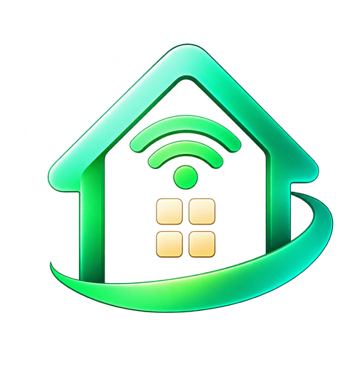
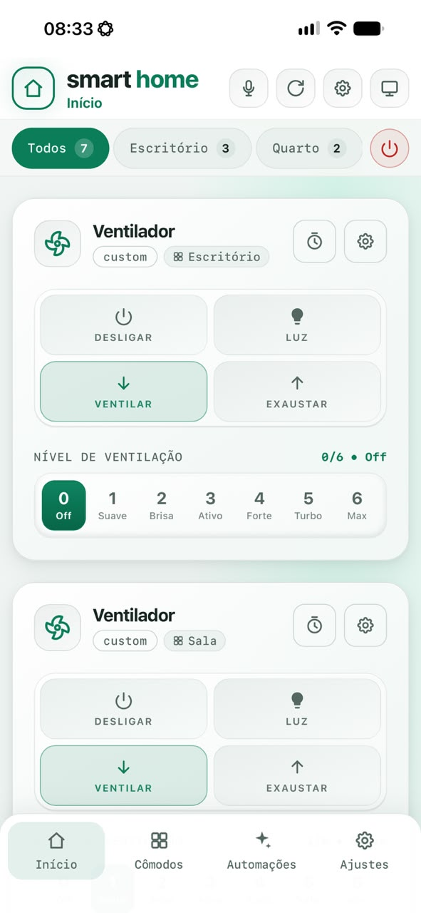

<p align="center">
  
</p>

<h1 align="center">Smart Home</h1>

Plataforma de automação residencial construída em torno de um **ESP32** que atua
como um **controle universal RF 433 MHz** (rádio **CC1101**): ele **aprende** os
comandos do controle físico e os **reproduz**. O primeiro perfil é o ventilador de
teto **Ventisol** (protocolo 18639) e o **suporte a IR (infravermelho) vem em
breve**. Um **hub em Raspberry Pi** (Go) descobre, comanda e espelha tudo, além de
integrar equipamentos de terceiros **Tuya** e **Midea** na rede local.

Este documento é a **documentação técnica mestra** do projeto: arquitetura,
contratos, protocolos (RF proprietário Ventisol, Tuya LAN/nuvem e Midea LAN/nuvem),
descoberta, varredura de LAN, banco de dados, API, automações, voz, segurança e
operação. Os documentos por componente continuam válidos como referência:

| Documento | Conteúdo |
|---|---|
| [`contracts/`](contracts/) | fonte de verdade do contrato device ↔ hub (manifesto, comandos, API HTTP, ingest, OTA) |
| [`firmware/smart_control/README.md`](firmware/smart_control/README.md) | firmware do ESP32 |
| [`hub/README.md`](hub/README.md) | hub Go (Pi) |

<p align="center">
  
</p>

---

## Sumário

1. [Visão geral e princípios](#1-visão-geral-e-princípios)
2. [Arquitetura](#2-arquitetura)
3. [Estrutura do repositório](#3-estrutura-do-repositório)
4. [Como começar](#4-como-começar)
5. [Contrato device ↔ hub](#5-contrato-device--hub)
6. [Firmware `smart_control` (ESP32)](#6-firmware-smart_control-esp32)
7. [Protocolo RF Ventisol 18639](#7-protocolo-rf-ventisol-18639)
8. [Hub Go (Raspberry Pi)](#8-hub-go-raspberry-pi)
9. [Banco de dados SQLite](#9-banco-de-dados-sqlite)
10. [Descoberta e varredura de LAN](#10-descoberta-e-varredura-de-lan)
11. [Protocolo Tuya](#11-protocolo-tuya)
12. [Protocolo Midea](#12-protocolo-midea)
13. [Automações (dispatch)](#13-automações-dispatch)
14. [Voz](#14-voz)
15. [UI web (design system modular)](#15-ui-web-design-system-modular)
16. [Tempo real (SSE)](#16-tempo-real-sse)
17. [OTA](#17-ota)
18. [API HTTP do hub](#18-api-http-do-hub)
19. [Segurança](#19-segurança)
20. [Deploy na Raspberry Pi](#20-deploy-na-raspberry-pi)
21. [Desenvolvimento, testes e CI](#21-desenvolvimento-testes-e-ci)
22. [Decisões de design](#22-decisões-de-design)
23. [Status e roadmap](#23-status-e-roadmap)
24. [Licença](#24-licença)

---

## 1. Visão geral e princípios

- **Firmware** (`firmware/smart_control/`): ESP32 + CC1101 como **controle
  universal RF 433 MHz** (aprende e reproduz comandos). Perfil atual: ventiladores
  de teto **Ventisol 18639**; **IR em breve**. Estado absoluto por sub-device,
  HTTP local sempre disponível e push de estado/status/eventos para o hub.
- **Hub** (`hub/`): binário Go para Raspberry Pi 2B+ (**armv7**), UI web (Svelte),
  SQLite como fonte de verdade, descoberta por manifesto/mDNS, integração Tuya e
  Midea, automações, voz e OTA.
- **Contratos** (`contracts/`): fonte de verdade do manifesto, comandos, API HTTP
  e ingest do hub.

Princípios transversais:

- **HTTP puro na LAN, nas duas direções.** O acesso remoto é feito por
  **Tailscale**.
- **O device é a fonte de verdade** do estado dos seus sub-devices. O hub só
  **espelha** o que o device reporta (cache quente em memória + réplica durável no
  SQLite); nunca inventa estado.
- **Um escritor por dado.** Comandos são síncronos e one-shot; não há fila de
  comandos nem arbitragem distribuída de "quem falou por último".
- **Descoberta por manifesto + mDNS.** Cadastrar só o **id + token** basta.
- **A UI renderiza por capability** e ignora o que não conhece — uma capability
  nova nunca quebra a tela.

---

## 2. Arquitetura

```
                        LAN / Tailscale (VPN L3)
   ┌───────────────┐                                    ┌───────────────────────────┐
   │ ESP32         │◀─── HTTP: comandos, config, OTA ───│ Raspberry Pi (armv7)      │
   │ smart_control │                                    │  hub (Go)                 │
   │  + CC1101     │──── HTTP: push de estado/status ──▶│  UI + SQLite              │
   └──────┬────────┘      e eventos                     │  + Tuya + Midea           │
          │ RF 433 MHz (Ventisol 18639)                  └──────┬───────────┬────────┘
          ▼                                                     │           │
   ventiladores de teto                            LAN TCP/UDP (Tuya)   LAN TCP/UDP (Midea)
                                                            ▼           ▼
                                                   tomadas/fechaduras   ar-condicionado
                                                   (nuvem + LAN)        (LAN)
```

Detalhes do fluxo:

- **hub → device**: o hub chama a API local do ESP32
  (`POST /api/state`, `/api/correct`, `/api/learn/*`, `/api/config`, `/api/update`…)
  com `Authorization: Bearer <token>`, sempre com resposta **síncrona**.
- **device → hub**: o ESP32 empurra para `POST /api/things/<thing>/events` com
  `Authorization: Bearer <sha256(token) em hex>` — `state` a cada mudança,
  `status` a cada 30 s (heartbeat) e `event` assíncrono.
- **Controle físico**: o **RX** do CC1101 capta o frame do controle original,
  identifica o ventilador/comando pelos frames aprendidos, atualiza o estado e
  empurra `source: "rf_remote"`. O hub reflete em segundos, **sem polling**.
- **Presença**: o hub considera o gateway online enquanto os batimentos não
  atrasarem mais de **90 s** (watchdog de 15 s). Após restart, a presença restaurada
  é sempre `offline` até o próximo batimento.
- **Tuya/Midea**: equipamentos de terceiros ficam **no hub**. O firmware do ESP32
  não os conhece. A regra é "LAN primeiro, nuvem como fallback" (ver §11 e §12).

---

## 3. Estrutura do repositório

```
contracts/                  manifesto, comandos, API HTTP e ingest do hub (fonte de verdade)
firmware/smart_control/     controle universal RF (PlatformIO, C++/Arduino-ESP32)
  src/                      main, config, manifest, hub_client, rf_ventisol, state,
                            http_server, wifi_provision, storage, ota, system, web_ui*
  partitions.csv            app0/app1 + otadata (OTA)
hub/                        hub Go
  cmd/smart-home-hub/       entrypoint
  internal/config/          JSON + variáveis de ambiente
  internal/model/           manifesto, status, estado (shapes JSON)
  internal/db/              SQLite (devices, cômodos, automações, specs, réplica de estado)
  internal/store/           inventário concorrente em memória (cache quente)
  internal/fallback/        cliente HTTP do device (Bearer token)
  internal/ota/             diretório de .bin, SHA-256 e rollback
  internal/hub/             orquestração: descoberta, comandos, ingest, presença, réplica, mDNS
  internal/httpapi/         API JSON + assets embutidos
  internal/tuya/            protocolo local Tuya (55AA/6699), nuvem e Message Service
  internal/tuya/service/    adaptador da UI (scan/registro/listen/controle/energia)
  internal/midea/           integração Midea (LAN + nuvem SmartHome)
  internal/dispatch/        automações (evento → ação lógica), desacopladas do transporte
  internal/voice/           comandos de voz (parser pt-BR + fallback LLM)
  web/app/                  front Svelte 5 + TS + Vite + Tailwind v4
  web/dist/                 build do front (gerado) embutido no binário Go
  deploy/                   scripts de deploy/instalação na Pi
docs/                       documentação de apoio
tools/                      utilitários (gerador de CSS)
```

---

## 4. Como começar

### 4.1 Firmware (ESP32)

Requisitos: Python 3.8+ e PlatformIO Core (`pipx install platformio`).

```bash
make -C firmware/smart_control build    # compilar
make -C firmware/smart_control upload   # gravar (PORT=/dev/ttyUSB0 para fixar)
make -C firmware/smart_control monitor  # monitor serial (115200)
```

No serial, provisione Wi-Fi e token:

```
wifi <ssid> <senha>
token <valor>              # >= 16 chars; o MESMO valor vai no cadastro do hub
```

A identidade do gateway (`THING_NAME`, default `smart-control-rf01`) é um default
de build, sobrescrevível com `-DTHING_NAME=...`. A URL de push do hub é
configurada **automaticamente** pelo hub ao descobrir o gateway (o serial
`hub <url>` serve só para depuração).

### 4.2 Hub (Raspberry Pi / dev)

Requisitos: Go 1.23+. O front usa Node/npm só para **rebuildar** o `web/dist`.

```bash
cd hub
make init     # cria config.json e firmware/
make check    # gofmt + vet + testes Go + testes do front (vitest)
make run      # sobe com -config config.json
```

Build para a Pi (armv7):

```bash
cd hub
make build-arm   # gera hub/smart-home-hub-linux-armv7
```

A UI sobe em `http://<pi>:8080/` (no deploy da Pi a porta é `:80`, então
`http://<pi>/`). Cadastre o gateway em **Configurações → Dispositivos** com o
**mesmo token** do device; a descoberta sonda `GET /api/manifest` e o device passa
a empurrar o estado.

---

## 5. Contrato device ↔ hub

`contracts/` é a fonte de verdade. Nada de código de produção deve divergir dali.

### 5.1 Transporte

| Direção | Como |
|---|---|
| hub → device | o hub chama a API local do device |
| device → hub | o device empurra estado/status/eventos (`POST /api/things/<thing>/events`) |

### 5.2 Autenticação

- Um **token por gateway**, configurado no device (serial/portal) e cadastrado no
  hub pela UI.
- **hub → device**: `Authorization: Bearer <token>`.
- **device → hub**: `Authorization: Bearer <sha256(token) em hex>`. O device guarda
  apenas o **digest SHA-256** na NVS, então nunca transmite o texto plano.
- Comparação em tempo constante dos dois lados. Por conveniência de operação, o
  hub também aceita o token em texto plano (permite testar com `curl`).

### 5.3 Descoberta

O hub lê `GET /api/manifest` (ver `contracts/manifest.schema.json`). Ele relê o
documento quando o `manifestVersion` anunciado no heartbeat muda, na sondagem
periódica e ao cadastrar/atualizar o gateway na UI.

### 5.4 Presença

O device manda heartbeat de 30 s; o hub o considera online enquanto os
batimentos não atrasarem (> 90 s vira `offline`).

### 5.5 Versionamento

- `manifest.schemaVersion` (atual **2**) muda **somente** em breaking change.
- O hub suporta a versão atual e a anterior e **ignora campos desconhecidos**.
- Uma capability nova que o hub não conhece não pode quebrar a UI.

### 5.6 Envelope de comando

Sucesso:

```json
{ "ok": true, "result": { } }
```

Erro:

```json
{ "ok": false, "error": { "code": "unknown_device", "message": "fan9 nao existe" } }
```

Códigos: `invalid_payload`, `unknown_device`, `busy`, `not_supported`,
`invalid_config`, `invalid_fan_count`, `invalid_sha256`, `rf_timeout`,
`rf_unavailable`, `cancelled`, `fan_limit`, `last_fan`, `invalid_name`,
`ota_failed`, `persist_failed`.

---

## 6. Firmware `smart_control` (ESP32)

O ESP32 é um **controle universal RF 433 MHz** (CC1101): aprende os comandos do
controle físico e os reproduz. O **perfil Ventisol** (ventiladores de teto,
protocolo 18639) é o primeiro; o **suporte a IR vem em breve**. Escopo: estado
absoluto por sub-device, HTTP local sempre ligado, push para o hub, SoftAP só para
provisionamento/recuperação e OTA.

### 6.1 Hardware e pinos

| Sinal | Pino |
|---|---|
| CC1101 SCK / MISO / MOSI / CSN | 18 / 19 / 23 / 5 |
| CC1101 GDO0 / GDO2 | 12 / 27 |
| LED | 2 |

Parâmetros de RF: `RF_FREQ_MHZ = 433.92`, `RF_BAUD = 4.0` (4.0 kBaud),
`RF_TX_ROUNDS = 4` repetições por transmissão, buffer de 63 bytes, guarda de
auto-transmissão (`SELF_TX_GUARD_MS = 1500`), timeout de aprendizado
(`LEARN_TIMEOUT_MS = 15000`), debounce de RX (`RF_RX_DEBOUNCE_MS = 500`),
captura de até `MAX_EDGES = 130` transições.

Modelo: `MODEL_NAME = smart_control_esp32`, `PROTOCOL_NAME = ventisol-18639`,
até `MAX_FANS = 8`, `COMMAND_COUNT = 11`.

### 6.2 Modelo de estado

Cada ventilador (`fan0`..`fan7`) tem:

- **Estado**: `power` (bool), `light` (bool), `speed` (0..6), `direction`
  (`forward`|`reverse`), `counter` (0..7), `source`, `updatedAt`.
- **Config**: `name` (1..32), e o mapa de **comandos aprendidos** (`hasCommand[]`
  + bytes do frame + `stateOffset`).
- **Origem da mudança** (`FanSource`): `boot`, `hub`, `http`, `rf_remote`,
  `correction`.

Regras de operação:

- Comandos comparam com o estado conhecido; **sem diff, não há RF** (a menos que
  `force: true` em `POST /api/state`).
- O frame `POWER` só é transmitido em **desligamento explícito** (`power: false`).
  Para ligar ou mudar de velocidade, o firmware usa o botão de velocidade aprendido
  (`vel_N`), nunca manda `POWER` junto.
- O botão **Desligar** envia `{ "power": false, "light": false }`.
- Em mudanças locais, todo o RF é transmitido **primeiro**; a persistência do
  estado/contador na NVS e o push só acontecem depois.
- Contador RF é persistido **por ventilador** (0..7) e usado tanto no comando
  aprendido quanto no fallback FIFO.

### 6.3 Partições de flash

O `partitions.csv` substitui a tabela padrão do ESP32 para ter **duas** partições
de aplicação (OTA):

| Partição | Offset | Tamanho | Uso |
|---|---|---:|---|
| `nvs` | `0x9000` | 20 KB | config dos fans, contador RF, Wi-Fi, token e URL do hub |
| `otadata` | `0xE000` | 8 KB | qual slot OTA (`app0`/`app1`) iniciar |
| `app0` | `0x10000` | 1.875 MiB | firmware — slot OTA 0 |
| `app1` | `0x1F0000` | 1.875 MiB | firmware — slot OTA 1 |
| `coredump` | `0x3D0000` | 64 KB | dump de crash |

**Não há SPIFFS/LittleFS**: a página web fica em `PROGMEM` e o estado/config vão
para a **NVS**. Cada slot tem 1.966.080 bytes; o build atual usa ~1,49 MB (75,6%).

### 6.4 UI local e CSS

A interface usa Tailwind, mas o CSS é **compilado e embutido** em
`src/web_ui_css.h` e servido em `/style.css` (sem CDN, sem internet). Ao alterar
`src/web_ui.h`, regenere o CSS com `./tools/gen-web-css.sh` (requer Node/npm só
nesse momento).

### 6.5 Comportamento

- **Boot**: carrega config/estado da NVS, conecta Wi-Fi, empurra `status` e todos
  os estados, e atende a sondagem de manifesto do hub.
- **RX**: capta o controle físico → identifica fan/comando pelo frame aprendido,
  atualiza o estado e empurra `state` com `source: "rf_remote"`.
- **TX**: guarda de ~1,5 s (`selfTxGuardUntil`) para o RX não captar a própria
  transmissão.
- **Direção** (`vent`/`exhaust`) é frame nativo: exige o comando aprendido; com o
  motor desligado o ventilador liga na velocidade 1. Não envie `power`/`speed`
  junto com `direction` (geraria um segundo frame e a direção se perderia).
- **Desligar** (`power: false`) é nativo: desliga motor e luz de uma vez.
- **Velocidades absolutas** exigem o `vel_N` aprendido; sem ele, `not_supported`.
  `speed: 0` usa `vel_0` aprendido (se existir) ou `power`.
- Na UI local: **toque** nos controles envia RF; **toque longo** (~0,6 s) usa
  `/api/correct` (estado sem RF). Não há botão "Corrigir estado".

### 6.6 Push para o hub

O device publica três tipos de mensagem em
`POST <hub_url>/api/things/<thing>/events`:

| `type` | Quando | Conteúdo |
|---|---|---|
| `state` | sempre que um ventilador muda | `id` + `reported` (power, light, speed, direction, source, updatedAt, counter) |
| `status` | heartbeat a cada 30 s e em mudanças de config/manifesto | versão, IP, RSSI, heap, uptime, `manifestVersion`, bloco `hub` |
| `event` | `learn.finished`, `ota.progress`, `ota.done`, `config.changed` | objeto do evento |

Regras:

- O POST sai **do `loop()`**, nunca de dentro de um handler HTTP, com timeout
  curto (`HUB_PUSH_TIMEOUT_MS = 4000`). O handler apenas enfileira
  (`hub_client_queue_*`).
- A fila de estado é **coalescida por ventilador** (estado absoluto → várias
  mudanças viram um único POST com o último valor).
- Eventos vão numa fila curta (6) e os mais antigos são descartados se encher.
- Falha → **backoff exponencial** de 5 s até 60 s. Sem hub configurado, o push
  fica desligado e o device funciona só com a API local.
- Ao conectar no Wi-Fi, o device empurra **todos** os estados e um status (o hub
  pode ter reiniciado sem ele).
- O `manifestVersion` no heartbeat permite ao hub reler o manifesto **quando
  muda**, em vez de revalidar num timer.

### 6.7 Serial

`help`, `status`, `ap`, `apoff`, `token <valor>`, `wifi <ssid> <senha>`,
`hub <url>`, `huboff`, `learn <id> <comando>`, `reset`, `reboot` (115200 baud).

### 6.8 Manifesto de descoberta

`GET /api/manifest` devolve o documento descrito em
`contracts/manifest.schema.json`. Exemplo:

```json
{
  "schemaVersion": 2,
  "manifestVersion": 4,
  "thing": "smart-control-rf01",
  "model": "smart_control_esp32",
  "protocol": "ventisol-18639",
  "firmware": { "version": "1.0.0", "build": "Nov  4 2026 20:49:47" },
  "http": { "mdns": "smart-control-rf01.local", "port": 80 },
  "events": { "state": true, "status": true, "heartbeat": 30 },
  "actions": ["fan.add", "fan.remove", "config.get", "config.set", "reboot", "ota.install"],
  "devices": [
    {
      "id": "fan0",
      "type": "ceiling_fan",
      "name": "Ventilador Sala",
      "capabilities": {
        "power": { "kind": "switch", "writable": true },
        "light": { "kind": "switch", "writable": true },
        "speed": { "kind": "number", "min": 0, "max": 6, "step": 1, "writable": true },
        "direction": { "kind": "enum", "values": ["forward", "reverse"], "writable": true }
      },
      "actions": ["state.correct", "learn.start", "learn.cancel", "fan.rename"]
    }
  ]
}
```

O `manifestVersion` é persistido na NVS (`manver`) e incrementado a cada mudança de
estrutura (add/remove de fan, `config.set`). É a **chave de invalidação** da
descoberta: quando o hub o vê diferente em um heartbeat, relê o manifesto.

---

## 7. Protocolo RF Ventisol 18639

O primeiro perfil do controle universal RF. É um protocolo **proprietário,
unidirecional (OOK/ASK)** a 433,92 MHz, ~4 kBaud, sem biblioteca pública: os frames
são **aprendidos do controle físico** e o transmissor reproduz o formato FIFO do
CC1101.

### 7.1 Frame lógico

O comando é **4 bytes**: `B0 B1 B2 B3`. Os dois primeiros identificam o fabricante/
família; o byte 2 é o **código da tecla**; o byte 3 carrega o **contador de
estado** e o **checksum**.

```
 00   0A   CC   SS
 └┬┘  └┬┘   │    └── byte de estado + checksum (nibble alto = estado)
  │    │    └─────── código do comando (POWER/PLUS/MINUS/OUTRO ou vel_N aprendido)
  └────┴─────────── prefixo fixo do protocolo (0x000A)
```

### 7.2 Codificação para o FIFO do CC1101

Cada **bit** do frame lógico é codificado como um **nibble** (PWM de 2 níveis) e
cada byte lógico vira 4 bytes no FIFO; o frame é repetido `RF_TX_ROUNDS = 4` vezes
com um terminador entre repetições. Implementação (`buildFifoBuffer`):

```
para cada byte proto P do frame (4 bytes):
  para cada par de bits (bitHi, bitLo) de P (4 pares, MSB→LSB):
      hiNibble = bitHi ? 0xE0 : 0x80
      loNibble = bitLo ? 0x0E : 0x08
      buffer[pos++] = hiNibble | loNibble     // ex.: 0xEE, 0xE8, 0x8E, 0x88
  // terminador do byte:
  buffer[pos++] = 0x80
  buffer[pos++] = 0x00
  buffer[pos++] = 0x00
  buffer[pos++] = 0x00
  buffer[pos++] = 0x00
repetir o bloco inteiro RF_TX_ROUNDS vezes
```

O transmissor então carrega esse buffer no `TXFIFO` do CC1101 e dispara `STX`,
aguardando o retorno a IDLE (MARCSTATE). A recepção decodifica o inverso: pulsos
curtos (< 450 µs) e longos (≥ 450 µs) em pares viram bits.

### 7.3 Tabela de estados (rolling code)

O byte 3 é escolhido por uma tabela de 4 linhas (comando genérico) × 8 colunas
(**contador 0..7**):

```c
static const uint8_t STATE_TABLE[4][8] = {
    { 0x03, 0x12, 0x21, 0x30, 0x47, 0x56, 0x65, 0x74 },  // POWER
    { 0x0C, 0x1D, 0x2E, 0x3F, 0x48, 0x59, 0x6A, 0x7B },  // PLUS  (velocidade +)
    { 0x0F, 0x1E, 0x2D, 0x3C, 0x4B, 0x5A, 0x69, 0x78 },  // MINUS (velocidade -)
    { 0x73, 0x04, 0x15, 0x26, 0x37, 0x40, 0x51, 0x62 },  // OUTRO (luz)
};
```

Repare que o **nibble alto é o contador** (0x03→0, 0x12→1, … 0x74→7) e o **nibble
baixo** é um valor derivado. O contador gira 0→7, garantindo que cada transmissão
seja diferente da anterior (é o "rolling code" do protocolo). Ele é **persistido
por ventilador**.

Bytes genéricos de fallback (sem aprendizado), usados quando o controle ainda não
foi aprendido:

| Comando | Byte (`RF_BYTE_*`) |
|---|---|
| POWER | `0x74` |
| PLUS  | `0x7B` |
| MINUS | `0x78` |
| OUTRO (luz) | `0x73` |

### 7.4 Checksum

O nibble baixo do byte 3 (SS) é uma função do nibble alto (estado) e do byte 2 (CC):

```
lowNibble = highNibble ^ ((B2 & 0x0F) ^ 0x07)
```

Na recepção, um frame com checksum inválido é descartado (`rxChecksumFail++`).

### 7.5 Recepção (RX) — captura por interrupção

O pino `GDO0` do CC1101 gera interrupção a cada mudança de nível. O handler
(`onRadioEdge`) mede a duração de cada transição:

- Duração **> 5 ms** (`> 5000 µs`) = **gap de sincronismo**: fecha o frame atual
  (se já tinha > 10 arestas) e começa um novo.
- Duração **< 80 µs** é ignorada (ruído).
- As demais são armazenadas em `durations[]`/`levels[]` (máx. 130).

`processCapturedFrame` então:

1. Ignora o eco da própria transmissão (guarda `selfTxGuardUntil`).
2. Acha o início dos dados (primeira transição longa > 3000 µs) e decodifica em
   pares: `(p1<450 && p2≥450) → bit 0`, `(p1≥450 && p2<450) → bit 1`.
3. Monta 4 bytes. Se não fechou exatamente 4 bytes, descarta.
4. Valida o checksum.
5. Identifica **fan + comando** procurando um frame aprendido em que B0/B1/B2
   batem. O contador é usado para desempatar: só um "candidato forte" (contador
   consistente) atualiza o estado; com 0 ou >1 candidatos, o frame é ignorado
   (evita atualizar o ventilador errado quando dois compartilham o frame).
6. Aplica **debounce** (`RF_RX_DEBOUNCE_MS = 500`) para rejeitar frames repetidos.
7. Atualiza o estado e enfileira o push (`state_onRfCommand`).

### 7.6 Aprendizado

`rf_startLearn(fan, command)` entra no modo "ouvindo" por até **15 s**. Ao captar um
frame válido (`learning == true`):

- Guarda os 4 bytes do frame e calcula o **offset de estado** entre o nibble alto
  captado e o contador do ventilador:
  `offset = (highNibble - ((counter + 7) & 0x07)) & 0x07`.
- Persiste `{ bytes, offset }` para aquele comando.
- Emite `learn.finished` (via push) com o frame em hex.

A transmissão de um comando aprendido (`transmitLearned`) reconstrói o byte 3 a
partir do contador atual e do offset, mantendo o rolling code em sincronia:

```
state       = (counter + stateOffset[cmd]) & 0x07
encodedState = (B3 & 0x80) | (state << 4)
B3          = encodedState | (state >> 4) ^ ((B2 & 0x0F) ^ 0x07)   // recomputa checksum
```

Sem comando aprendido, cai no fallback FIFO (só POWER/luz/vel_0). Direção
(`vent`/`exhaust`) **exige** aprendizado — o código `OUTRO` é o da luz e não serve
de fallback.

### 7.7 Comandos do protocolo (11)

`power`, `light`, `vel_0` … `vel_6`, `exhaust`, `vent`. Os nomes são os mesmos do
estado/config e da API.

---

## 8. Hub Go (Raspberry Pi)

Fala HTTP puro com os ESP32, comanda a API local, recebe o estado por push, serve a
UI web, mantém a réplica do estado no SQLite, coordena OTA e integra Tuya/Midea.

### 8.1 Configuração

`config.json` (ignorado pelo git; tem credenciais Tuya/Midea). Campos principais:

| Campo | Uso |
|---|---|
| `http_addr` | endereço da UI/API (default `:8080`) |
| `db` | banco SQLite (devices, cômodos, automações, specs, `local_key`) |
| `tuya_access_id` / `tuya_access_secret` / `tuya_region` | credenciais da nuvem Tuya |
| `tuya_auto_listen` | mantém listener LAN aberto por device Tuya (default `true`) |
| `tuya_refresh_seconds` | cadência da telemetria LAN (default `5`) |
| `tuya_cloud_poll_seconds` | cadência da leitura na nuvem dos `cloud_only` (default `300`) |
| `tuya_event_poll_seconds` | cadência do poll de `/report-logs` (default `60`) |
| `tuya_cloud_push` / `tuya_cloud_push_test` | push do Message Service (Pulsar) |
| `midea_username` / `midea_password` / `midea_cloud` | conta SmartHome (buscar credencial LAN) |
| `automation_grace_seconds` | tolerância para automação de horário atrasada (default `120`) |
| `voice_llm_enabled` / `voice_llm_url` / `voice_llm_key` / `voice_llm_model` | fallback de voz por LLM |

Tokens e URLs por thing, cômodos e automações **não** ficam no `config.json`: são
cadastrados na UI e persistidos no SQLite. Variáveis de ambiente têm precedência
(`HUB_HTTP_ADDR`, `HUB_DB`, `TUYA_ACCESS_ID`, `TUYA_ACCESS_SECRET`,
`TUYA_REGION`, `MIDEA_USERNAME`, `MIDEA_PASSWORD`, `VOICE_LLM_*`, `HUB_CONFIG`…).

### 8.2 Descoberta, comandos e réplica de estado

- **Sondagem HTTP**: no boot e enquanto um gateway não tem manifesto em memória, o
  hub chama `GET /api/manifest` a cada **5 s**; com o manifesto em cache, revalida
  a cada **60 s**. Cadastrar/atualizar um gateway dispara sondagem imediata; o
  heartbeat com `manifestVersion` novo também dispara releitura (com throttle de
  30 s).
- **URL de push automática**: após cada sondagem bem-sucedida, o hub chama
  `POST /api/hub` no gateway com a própria URL (`http://<ip-da-lan>:<porta>`). É um
  **IP**, não um nome `.local` (o cliente HTTP do ESP32 não resolve mDNS). A
  chamada é idempotente.
- **Comandos**: `POST /api/state` (`force: true` reenvia o RF), `POST /api/correct`
  (sem RF), learn, config, `fan.*`, reboot e OTA multipart. Sem token/URL para o
  gateway, o comando falha com `fallback_unavailable`. Não há retry automático.
- **Réplica do estado**: cada sub-device tem **cache quente** (memória,
  `internal/store`) e **réplica durável** (`thing_states`). No boot o hub chama
  `LoadState` **antes** da descoberta e marca o que restaurou como `stale: true`
  até o device confirmar. A réplica só é escrita pelo que o device reporta.
- **Remoção em cascata**: remover um ventilador (`fan.remove`, sub-device que sumiu
  do manifesto ou gateway apagado) apaga a linha correspondente.

### 8.3 Reconciliação de ventiladores

Quando o firmware reindexa os slots (`fan.remove` → `fan1` vira `fan0` etc.), o hub
remapeia pelo **id do sub-device** (estável) primeiro. O **nome** só é usado para
casar um slot que sumiu, e apenas quando o nome é **único** no manifesto — assim
renomear todos os ventiladores para o mesmo nome não move nem apaga nenhum.

O nome de exibição do hub (`devices.name`) e o nome no firmware
(`devices.firmware_name`, vindo do manifesto) são **independentes**: renomear no
hub (`fan.rename`) não chama o device; renomear na UI do ESP32 só atualiza
`firmware_name`. A UI mostra "No dispositivo: …" quando divergem.

### 8.4 Presença e diagnóstico

- Watchdog a cada 15 s marca offline quem silenciar mais de 90 s, mantendo os
  últimos diagnósticos (IP, versão, RSSI).
- `GET /api/things/{thing}/diag` espelha o `/api/diag` do firmware (RF/NVS/heap/
  uptime/hub).

### 8.5 Configuração do banco de dispositivos

O hub guarda no SQLite tudo que não é descoberto automaticamente:

- **Gateways (ESP32)** — `kind: "thing"`: token LAN e URL opcional. O `id` é a
  **identidade** (campo `thing` do manifesto); o `name` é só exibição.
- **Sub-devices** — `kind: "fan"`: descobertos pelo manifesto e cadastrados
  automaticamente (id `gateway/fan0`), cada um com o seu cômodo.
- **Tuya** — `kind: "tuya"`: `local_key`, `category`, specs e estado.
  `cloud_only` marca os que dormem (fechaduras).
- **Midea** — `kind: "midea"`: token/chave LAN, specs e estado.
- **Cômodos** (`rooms`), **associações** ventilador→cômodo e **automações**.
- **Layouts**: cada device tem uma coluna `template` (vazia = inferir pelo tipo/
  capabilities).

---

## 9. Banco de dados SQLite

Fonte de verdade do hub, versionado por `PRAGMA user_version` (atual **17**) e
migrado na abertura. Tabelas:

| Tabela | Conteúdo |
|---|---|
| `devices` | devices unificados (`kind`: `thing`/`fan`/`tuya`/`midea`), `ip`/`port`, `local_key`, `token`, `url`, `room_id`, `template`, `category`, `cloud_only`, `firmware_name`, `device22`, `key_source`… |
| `rooms` | cômodos (`id`, `name`, `icon`, `sort`) |
| `placements` | associação legada `kind/owner/device → room_id` |
| `automations` | `id`, `name`, `enabled`, `once`, `source` (JSON), `schedule` (JSON), `delay` (JSON), `actions` (JSON) |
| `tuya_specs` | specs de DP cacheadas da nuvem (`device_id`, `dp_id`, `code`, `name`, `desc`, `type`, `values_json`, `writable`) |
| `tuya_state` | último estado conhecido por DP |
| `midea_specs` | funções suportadas pelo aparelho Midea |
| `midea_states` | estado lógico por chave (`power`, `mode`, `target_temp`, …) |
| `thing_states` | **réplica durável** do estado reportado dos sub-devices (`thing`, `device_id`, `reported`, `source`, `device_ts`, `received_at`) |
| `thing_status` | réplica do status/liveness do gateway (`status`, `manifest_version`, `last_seen`) |
| `tuya_report_cursor` | cursor de eventos (`/report-logs`) por device `cloud_only` |

Migrações relevantes: v7 (nome/descrição do DP Tuya), v12 (`firmware_name`), v13
(`category`/`cloud_only`), v14 (cursor de report-log), v15 (janela de horário da
automação), v16 (`delay`), v17 (`once`/volátil).

O banco é **estado, não artefato**: `make seed-db` roda separado e é opt-in (usa
`VACUUM INTO` para um snapshot consistente). Depois do primeiro seed, a Pi é a
fonte de verdade.

---

## 10. Descoberta e varredura de LAN

O hub usa **mecanismos distintos** por família:

### 10.1 ESP32 (gateways `smart_control`)

1. **mDNS**: o firmware publica `_http._tcp` com o host
   (`smart-control-rf01.local`) e um TXT `thing=<thing>`. Como o resolver do Go
   **não** faz mDNS, o hub faz a busca ele mesmo (`github.com/hashicorp/mdns`) a
   cada **30 s**. O endereço anunciado (`http://<ip>:<porta>`) fica em memória e é
   usado para alcançar o gateway **antes** de existir URL/IP/manifesto.
   - Um anúncio **nunca cadastra nada sozinho**: só ensina um endereço; registrar é
     decisão do operador.
   - Se o gateway anunciado **já está cadastrado** e ainda sem manifesto, o hub
     dispara a sondagem — **cadastrar só o id + token basta**.
2. **HTTP (manifesto)**: o hub sonda `GET /api/manifest` (precedência de endereço:
   URL configurada não-`.local` → IP do status → endereço mDNS → URL `.local` → nome
   do manifesto).
3. **Push**: depois que o hub configura a URL via `POST /api/hub`, o estado passa a
   chegar sozinho.

### 10.2 Tuya

Descoberta **UDP**: o hub escuta as portas **6666, 6667 e 7000** e decodifica os
broadcasts. Para devices 3.5, envia uma **solicitação** por broadcast em
**UDP/7000**. Não há mDNS nem varredura TCP cega. Detalhes em §11.3.

### 10.3 Midea

Descoberta **UDP broadcast** nas portas **6445 e 20086** (pacote de descoberta
`0x5A5A…`), com fallback para tentar IPs conhecidos quando o AP isola broadcast.
Detalhes em §12.2.

---

## 11. Protocolo Tuya

Implementado em `hub/internal/tuya/` (LAN + nuvem) e
`hub/internal/tuya/cloudstream/` (push). É um protocolo **proprietário**, com
arquitetura cliente/servidor sobre TCP.

### 11.1 Visão geral

- **Porta de dados TCP**: **6668** (default).
- **Chave**: `local_key` de **16 bytes**, obtida na nuvem Tuya (Access ID/Secret).
- **Versões de protocolo**: **3.1, 3.2, 3.3, 3.4, 3.5**. A versão é detectada uma
  vez (`Detect`) tentando 3.5, 3.3, 3.4, 3.1, 3.2 (as mais comuns primeiro) e
  persistida.
- **Dois formatos de frame**: `55AA` (v3.1–3.4) e `6699` (v3.5).

### 11.2 Enquadramento (framing)

**Formato 55AA** (v3.1–3.4) — header de 16 bytes + payload + trailer:

```
[0:4]   prefix   0x000055AA (big-endian)
[4:8]   seq      contador de sequência
[8:12]  cmd      comando (ver tabela)
[12:16] length   tamanho de (payload + trailer)
[16:]   payload
trailer: CRC32(4) + 00 00 AA 55         (v3.1–3.3)
         HMAC-SHA256(32) + 00 00 AA 55   (v3.4+, chave = session key)
```

Respostas **do device** incluem um `retcode` (4 bytes) logo após o header; nos
nossos frames (cliente→device) ele não existe. O parser tenta ambas as leituras na
descoberta.

**Formato 6699** (v3.5) — header de 18 bytes, depois `IV(12) + ciphertext + GCM tag(16)`
e footer:

```
[0:4]   prefix   0x00006699 (big-endian)
[4:6]   zero
[6:10]  seq
[10:14] cmd
[14:18] length   = 12 (IV) + len(ciphertext) + 16 (tag)
[18:30] IV (12 bytes aleatórios)
[30:]   AES-128-GCM ciphertext+tag
footer: 00 00 99 66
```

O GCM usa a chave (local key para handshake, session key depois) e **AAD =
header[4:18]**.

### 11.3 Descoberta (UDP)

- Portas **6666, 6667 e 7000**. O `Discover` é serializado por um semáforo (as
  portas UDP só podem ser bindadas uma vez).
- Para devices **3.5**, envia uma **solicitação** em UDP/7000:
  `{"from":"app","ip":"<ip-local>"}` no comando `0x25` (dev info), empacotado em
  6699 com a **discovery key**.
- `discoveryKey = md5("yGAdlopoPVldABfn")` (chave pública/fixa).
- Decodificação por versão:
  - **3.1**: broadcast é **JSON em texto plano**.
  - **3.2/3.3**: AES-ECB com a discovery key (às vezes atrás de um header de 15
    bytes `"3."`), podendo vir base64.
  - **3.5**: frame 6699 cifrado com a discovery key.
- Extrai `gwId`/`devId`/`id`/`dev_id`, `ip`, `version`, `productKey`. Respostas que
  ecoam `"from":"app"` são ignoradas.

### 11.4 Handshake de sessão (3.4 / 3.5)

Para 3.4/3.5, após conectar é feito um handshake de 3 mensagens:

1. **SESS_START (`0x03`)**: cliente envia um `clientNonce` de 16 bytes (em 3.4,
   `AES-ECB(realKey, clientNonce)` com padding).
2. **SESS_RESP (`0x04`)**: device devolve `deviceNonce(16) || HMAC-SHA256(realKey, clientNonce)(32)`.
   O cliente valida o HMAC (chave local errada → erro).
3. **SESS_FINISH (`0x05`)**: cliente envia `HMAC-SHA256(realKey, deviceNonce)`.

**Chave de sessão**:

- **3.4**: `AES-ECB(realKey, clientNonce XOR deviceNonce)` sem padding.
- **3.5**: `AES-GCM(realKey, iv=clientNonce[:12], clientNonce XOR deviceNonce)[:16]`.

### 11.5 Criptografia de payload por versão

`encodePayload`/`decodePayload` aplicam header e cifra conforme a versão. Comandos
"sem header de protocolo" (`noProtocolHeader`): `DP_QUERY`, `DP_QUERY_NEW`,
`UPDATEDPS`, `HEARTBEAT`, `SESS_*`, `LAN_EXT`.

| Versão | Como o payload é cifrado |
|---|---|
| **3.1** | `CONTROL` = `"3.1"` + `md5("data="+b64+"||lpv=3.1||"+key)[8:24]` + `base64(AES-ECB(json))`; outros plaintext |
| **3.2/3.3** | AES-ECB com a **local key**; header de 15 bytes `"<version>"+zeros` nos comandos que o levam |
| **3.4** | AES-ECB com a **session key**; header opcional |
| **3.5** | Cifra no **frame GCM**; payload plaintext com header opcional |

### 11.6 Comandos (IDs)

| ID | Nome | Uso |
|---|---|---|
| `0x03` / `0x04` / `0x05` | SESS_START / RESP / FINISH | handshake 3.4/3.5 |
| `0x07` | CONTROL | escrever DP (≤ 3.3) |
| `0x08` | STATUS | status |
| `0x09` | HEARTBEAT | keep-alive |
| `0x0A` | DP_QUERY | consultar DPs (≤ 3.3) |
| `0x0D` | CONTROL_NEW | escrever DP (3.4+) |
| `0x10` | DP_QUERY_NEW | consultar DPs (3.4+) |
| `0x12` | UPDATEDPS | atualizar DPs |
| `0x40` | LAN_EXT | extensão LAN |
| `0x25` | DEV_INFO | info/discovery |

**Payloads montados pelo hub** (`payload.go`):

- `BuildQuery`: `{}` para 3.4+; senão `{gwId, devId, uid, t}`. Modo *device22* usa
  uma lista explícita de DPs (`{"dps":{"1":null,…}}`) e o comando `CONTROL_NEW`.
- `BuildControl`: 3.4+ → `{protocol:5, t, data:{dps:{dp:value}}}`; senão
  `{devId, uid, t, dps:{dp:value}}`.
- `BuildHeartbeat`: `{gwId, devId}`.

`ParseDPs` aceita o formato plano (`{"dps":{…}}`) e o aninhado
(`{"data":{"dps":{…}}}`).

### 11.7 Cliente LAN e ciclo de vida

- `Dial` valida a chave (16 bytes), conecta em TCP/6668 e, para 3.4/3.5, faz o
  handshake.
- `Status` faz `DP_QUERY` e devolve os DPs; se o device responder `data unvalid`,
  liga o modo *device22* e tenta de novo.
- `Set` escreve um DP e aguarda o ACK.
- `Query`/`SetNoWait` **não esperam** a resposta — usados quando o **listener** é
  dono da conexão (devices Tuya costumam aceitar **uma única** conexão TCP).
- `Listen` conecta, emite o **snapshot inicial** e então faz streaming de DPs, com
  reconexão e backoff exponencial (1 s → 30 s). Envia `HEARTBEAT` quando fica
  ocioso.
- **Rediscovery por ID**: se o IP configurado parar de responder, o cliente procura
  o device por ID via descoberta UDP e atualiza o IP (`OnIPChange`).

### 11.8 Nuvem Tuya (IoT Platform)

Usada **só para obter as chaves** (`local_key`), specs e, para devices
`cloud_only`, leitura/comando e energia. Hosts por data center (`cloudHosts`):

| Região | Host |
|---|---|
| `us` / `az` | `openapi.tuyaus.com` |
| `us-e` / `ue` | `openapi-ueaz.tuyaus.com` |
| `eu` | `openapi.tuyaeu.com` |
| `eu-w` / `we` | `openapi-weaz.tuyaeu.com` |
| `cn` / `ay` | `openapi.tuyacn.com` |
| `in` | `openapi.tuyain.com` |
| `sg` | `openapi-sg.iotbing.com` |

**Assinatura** de cada requisição (HMAC-SHA256):

```
payload = clientID [+ accessToken] + t + METHOD + "\n"
          + sha256(body) + "\n"
          + ["Content-type:application/json\n"] + "\n"
          + path?query
sign    = HMAC-SHA256(accessSecret, payload) em HEX maiúsculo
```

Headers: `client_id`, `sign`, `t`, `sign_method: HMAC-SHA256`, `mode: cors`,
`access_token`. A query é assinada **com vírgulas literais** (não URL-encoded).
Um offset de relógio é corrigido com o `t` do servidor (skew grande → `code 1004`).

Endpoints usados: `/v1.0/token` (grant_type=1), `/v1.0/devices/{id}`,
`/v1.0/users/{uid}/devices`, `/v1.1/devices/{id}/specifications`,
`/v1.0/devices/{id}/commands`, `/v1.0/devices/{id}/status`,
`/v1.0/iot-03/energy/electricity/devices/statistics-trend`,
`/v1.0/iot-03/devices/{id}/report-logs`, e os do Smart Lock Open Service
(`/v1.0/devices/{id}/door-lock/open-logs`, …).

### 11.9 Message Service (Pulsar) — push da nuvem

`internal/tuya/cloudstream` assina o tópico
`persistent://<access_id>/out/event` (ou `out/event-test`) no broker da região
(`pulsar+ssl://mqe.<dc>.tuyaus.com:7285/`):

- **Auth**: método `auth1`; senha = `md5(accessId + md5hex(accessSecret))[8:24]`.
- **Assinatura**: `<access_id>-sub`, tipo **Failover**.
- **Payload**: envelope JSON com `data` cifrado em **AES-GCM** — chave
  `accessSecret[8:24]`, `nonce(12) || ciphertext || tag(16)`.
- Decodifica o `statusReport` (`devId`, `productKey`, `status[].code/value/t`) e
  entrega ao serviço. Toda mensagem é **ackada** (mesmo ignorada) para um poison
  message não travar o consumo.
- Só conecta **se houver algum device `cloud_only`** (não consome cota à toa).
  Depende de habilitar o Message Service + a Messaging Rule no projeto Tuya.

### 11.10 Serviço Tuya no hub (`tuya/service`)

- **Scan** (`GET /api/tuya/scan`): descoberta UDP; marca os já registrados.
- **Registro**: `POST /api/tuya/register` busca o `local_key` na nuvem; o mesmo
  endpoint cobre devices que **nunca aparecem na LAN** (fechaduras que dormem) via
  **"Listar da nuvem"** (`GET /api/tuya/cloud`).
- **Auto-listen**: mantém um listener LAN aberto por device registrado e relê a
  telemetria periodicamente na **mesma conexão** (`tuya_refresh_seconds`, default
  5 s). O botão **Parar** desliga só aquele device até um novo "Ouvir".
- **Controle** (`POST /api/tuya/control`): LAN primeiro, nuvem como fallback;
  para `cloud_only`, nuvem primeiro e LAN como reserva. A nuvem resolve o `code` a
  partir das specs.
- **Estado**: `tuya_state` persistido; `GET /api/tuya/state` devolve o último valor
  sem falar com o device; `POST /api/tuya/state` relê (`DP_QUERY` na LAN, nuvem como
  fallback).
- **Specs**: da nuvem (`tuya_specs`, com `name`/`desc`); sem nuvem, o hub **infere**
  dos DPs observados (`Kind`/`Integer`/`String`) para controlar via LAN. Um
  dicionário curado pt-BR no front (`DP_INFO`) cobre códigos comuns.
- **Energia** (`GET /api/tuya/energy`): a fonte primária é o **log de relatos** do
  device (`/report-logs`, código `add_ele`), somando incrementos por hora/dia com a
  escala do DP; fallback para `statistics-trend`. Resposta autodescritiva
  (`available`/`reason`).
- **Records** (`GET /api/tuya/records`): histórico de aberturas de fechadura
  (`door-lock/open-logs`).

### 11.11 Devices que dormem (`cloud_only`)

Fechaduras de bateria (categorias `jtmspro`, `ms`, `mk`, `jtmsbh`, `gyms`,
`hotelms`, `videolock`, `photolock`) não ficam conectadas. Quando registrados pela
nuvem, entram como **`cloud_only`**: sem listener LAN, estado lido pela nuvem
(`tuya_cloud_poll_seconds`, default 300 s) e `online` mantido durante a janela do
poll.

**Eventos sem listener** (para automações) vêm de dois caminhos que **compartilham
o mesmo cursor por device** (`tuya_report_cursor`), então nunca disparam duas vezes
o mesmo evento:

- **push (Pulsar, preferido)**: entrega o relato no instante em que a nuvem o
  recebe (§11.9).
- **poll (`/report-logs`, fallback)**: a cada `tuya_event_poll_seconds` (default
  60 s). O cursor é **semeado** no primeiro contato (olhando o histórico) e persiste,
  então ligar uma automação **não repercute** aberturas antigas nem depois de
  restart.

O modo é **por device** e vale para qualquer Tuya: no detalhe do dispositivo há
**"Ler pela nuvem"** (liga/desliga).

---

## 12. Protocolo Midea

Integração `hub/internal/midea/`: aceita aparelhos de ar-condicionado **Midea V3**
na LAN. A nuvem SmartHome é usada **só** para obter token/chave individuais no
cadastro.

### 12.1 Visão geral

- **Porta de dados TCP**: **6444**.
- **Credenciais**: `token` (64 bytes) e `key` (32 bytes), em hex, obtidos na nuvem.
- **Frames**: `8370` (transporte externo) envolvendo um pacote `5A5A` (interno),
  que por sua vez carrega um **command frame** `0xAA`.

### 12.2 Descoberta (UDP broadcast)

- Enviado para as portas **6445 e 20086** (3 pacotes cada, timeout ~5 s).
- Pacote de descoberta fixo (`5A5A 01 11 48 00 92 00 …`) e **AES key** fixa
  (`6a 92 ef 40 6b ad 2f 03 59 ba ad 99 41 71 ea 6d`).
- O hub deriva os **broadcasts** das interfaces IPv4 privadas (ou usa
  `255.255.255.255`) e também aceita um `target` explícito.
- `ParseResponse` aceita **V2** (pacote começa `5A5A`) e **V3** (começa `8370`,
  inner `5A5A` em `data[8:…]`). Decifra o corpo (AES-ECB com a discovery key),
  extrai:
  - **ID** (6 bytes little-endian em `packet[20:26]`),
  - **porta** (`reply[4:8]` LE; default 6444),
  - **tipo** (do SSID `xxxx_<hex>`; ar-condicionado = **172**),
  - **modelo** (`reply[17:25]`),
  - `protocol` 2 ou 3.
- O serviço só considera **V3, tipo 172** (`d.Type == 172 && d.Protocol == 3`).
- Se o broadcast achar nada (AP que isola clientes), tenta **IPs conhecidos**
  diretamente.

### 12.3 Enquadramento 8370 (transporte)

Header de 6 bytes: `83 70 size_hi size_lo 20 type`.

| `type` | Significado |
|---|---|
| `0x00` | HANDSHAKE_REQUEST (sem cifra) |
| `0x01` | HANDSHAKE_RESPONSE |
| `0x03` | ENCRYPTED_RESPONSE |
| `0x06` | ENCRYPTED_REQUEST |

Para mensagens cifradas: o dado é preenchido aleatoriamente para que `(len+2)` seja
múltiplo de 16, cifrado em **AES-128-CBC** (IV zero, chave = **tcp_key**) e recebe
um **SHA-256(header + plaintext)** como assinatura. Um **contador de requisição**
de 2 bytes (wrap em `0xFFFF`) precede os dados.

`totalSize = size_field + 8`.

### 12.4 Pacote 5A5A (interno) e command frame 0xAA

- **5A5A**: header de 40 bytes (`5A 5A 01 11`, length LE, `20 00`,
  `message_id`, **timestamp BCD invertido** em `[12:20]`, `deviceID` LE em
  `[20:28]`), + 48 bytes do **command frame cifrado em AES-128-ECB** (chave =
  `md5(signKey)`), + 16 bytes de **MD5(pkt + signKey)**.
  - `signKey = "xhdiwjnchekd4d512chdjx5d8e4c394D2D7S"` (constante pública do
    protocolo).
  - **Heartbeat** é um 5A5A mínimo (byte 3 = `0x10`, byte 6 = `0x7B`) a cada 10 s.
- **Command frame 0xAA**: header de 10 bytes (`AA`, `len`, `AC`, 6 zeros, `frameType`),
  body = `[bodyType, payload…, message_id, crc8_854]`, e um **frame checksum**
  `(~sum(data)+1)&0xFF` no último byte. `frameType`: `0x02` set, `0x03` query.

`bodyType`s relevantes:

| bodyType | Uso |
|---|---|
| `0x40` | set (estado completo) |
| `0x41` | query (status / energia) |
| `0xB0` | set properties |
| `0xB5` | capabilities |
| `0xC0` | resposta de estado |
| `0xC1` | resposta de energia |

### 12.5 Handshake V3

1. Cliente envia o **token de 64 bytes** num HANDSHAKE_REQUEST (`0x00`).
2. Device responde; o cliente lê o payload de **64 bytes** em `[8:72]`
   (a referência em Python não decodifica o 8370 aqui — só recorta).
3. **Derivação da tcp_key** (`deriveTCPKey`): `plain = AES-CBC-decrypt(response[:32], key32)`;
   valida `SHA-256(plain) == response[32:64]`; `tcp_key = plain XOR key32`.
4. Delay pós-auth de ~1 s (configurável; o hub usa ~250 ms) e início do **heartbeat**.

Se o device responder `ERROR` no handshake, é falha de autenticação
(`ErrAuthFailed`).

### 12.6 Comandos

- **Query** (`buildQueryCmd`, body `0x41`): corpo fixo; resposta `0xC0`.
- **Set** (`buildSetCmd`, body `0x40`): 23 bytes codificando o **estado completo**
  (o formato Midea **não tem** "sem mudança"). Byte layout (referência msmart-ng):
  - `[1] control_source | beep | power`
  - `[2] mode<<5 | temp_int | temp_half` (temperatura primária 17–30 °C)
  - `[3] fan_speed`, `[4-6] timer (0x7F 0x7F 0x00)`, `[7] swing`, `[8] follow_me|turbo`,
    `[9] eco|purifier|aux_heat`, `[10] sleep|turbo|fahrenheit`, `[18] temp alternativo`
    (12–43 °C), `[19] umidade alvo`, `[21] frost`, `[22] comfort`.
- **Toggle display**: comando **QUERY** (não o set) — o device responde `0xC0`.
- **Capabilities** (`0xB5`): duas consultas (padrão + adicional), mescladas.
- **Energia** (`0x41` com payload `21 01 44`): resposta `0xC1`.
- **Set properties** (`0xB0`): propriedades avançadas por ID (`0x0009`/`0x000A` ângulo,
  `0x0043` breeze, `0x0233` ar externo, `0x0025` out silent, `0x0039` self clean).

Enums: `Mode` (auto/cool/dry/heat/fan), `FanSpeed` (silent=20/low=40/medium=60/
high=80/full=100/auto=102), `BreezeMode`, `FreshAirSpeed`, `SwingAngle`.

### 12.7 Decodificação da resposta 0xC0

`parseC0Body` (>= 23 bytes):

- `[1]` bit0 = power, bit7 = erro; `[2]` modo (bits 5-7) + temp (`(b&0x0F)+16`, +0.5 se
  bit4); `[3]` fan; `[7]` swing V/H; `[8]` follow_me/turbo; `[9]` eco/purifier/aux_heat;
  `[10]` fahrenheit/sleep; `[11]`/`[12]` temperatura interna/externa
  (`(raw-50)/2`, `0xFF` = ausente); `[13]` umidade + filtro; `[14]` display
  (`0x70` = tela apagada); `[16]` errCode; `[19]` umidade alvo; `[21]` frost;
  `[22]` comfort.

### 12.8 Energia (0xC1)

Bytes em **BCD**, divisor **100** (kWh na unidade 0.01): `[4:8]` total acumulado,
`[12:16]` ciclo atual, `[16:19]` potência instantânea (0,1 W → /10000 = kW). O hub
cacheia ~30 s e expõe `/api/midea/energy?range=run|total`.

### 12.9 Nuvem SmartHome

`internal/midea/cloud`: só a identidade **SmartHome (MSmartHome)** é implementada
(`appID 1010`, `iotKey meicloud`, endpoint `https://mp-prod.appsmb.com/mas/v5/app/proxy?alias=`).
Fluxo:

1. `Login`: rota opcional → `loginID` → `POST /mj/user/login` com senhas cifradas
   (`encryptPassword` = SHA-256(loginID + sha256hex(senha) + loginKey);
   `encryptIAMPassword` usa MD5 duplo). A sessão AES é aberta com as chaves
   retornadas (`setSessionKeys`).
2. `ListAppliances`: `POST /v1/appliance/user/list/get`; o **SN** vem cifrado e é
   decifrado com a sessão; o **modelo** é derivado do SN (`SN[9:17]`).
3. `GetToken`: `POST /v1/iot/secure/getToken` com `udpid` (um dos três métodos de
   codificação do ID: `UDPPIDReversedBig`, `UDPPIDBig`, `UDPPIDLittle`) e
   `applianceCodes`; devolve `token`/`key` (hex minúsculo).

**Assinatura** da nuvem: header `sign = HMAC-SHA256(hmacKey, iotKey + body + random)`
(hex), mais `random`, `secretVersion: 1`, `x-recipe-app`, `authorization` (Basic
`appKey:iotKey`), `uid`, `accessToken`.

### 12.10 Serviço Midea no hub

- **Registro** (`POST /api/midea/register`): descobre o aparelho na LAN, testa os
  três métodos de `udpid` na nuvem, **verifica** a credencial direto no aparelho
  (`verify`), grava no SQLite e **cacheia** specs e estado inicial.
- **Controle** (`POST /api/midea/control` → `Apply`): traduz o estado lógico
  (`power`, `mode`, `target_temp`, `fan_speed`, `swing_v/h`, `eco`, `turbo`,
  `sleep`, `display`, `breeze`, `airflow_angle`, `fresh_air`, `out_silent`, `clean`)
  em `lan.Request`/`PropertiesRequest`. Redescobre pelo ID se a conexão falhar.
- **Estado**: conexão LAN autenticada recebe mudanças **não solicitadas** (stream);
  o hub persiste e publica por SSE. Um `RefreshIPs` (1 min) redescobre o IP pelo ID;
  um `PollStates` lento é fallback de recuperação. `GET /api/midea/state` devolve o
  último estado salvo sem tocar na rede; `POST` consulta na LAN.
- **Online**: cacheado (não diala a cada render) — link vivo ou visto nos últimos
  90 s.
- **SSE** `type: "midea"` com `{device, state}`; automações podem ter o ar como
  **gatilho** (`midea_state`) e **alvo** (`kind: "midea"`).

---

## 13. Automações (dispatch)

`internal/dispatch`: liga um **evento** a uma **ação lógica**, desacoplado do
transporte. Quem decide como executar é o hub.

### 13.1 Fontes (`source.type`)

| Tipo | Dispara em |
|---|---|
| `tuya_dp` | um data point Tuya (`dp` = id; `dps` pode listar vários métodos; `value` vazio = qualquer) |
| `midea_state` | uma chave de estado Midea (`power`, `mode`, `target_temp`, …) |
| `thing_state` | um sub-device de gateway (ex.: `rf01/fan0`, `dp: "light"`) |
| `manual` | só disparo manual (`POST /api/automations/{id}/run`) |
| `time` | **volátil**: dispara num instante (ver §13.4) |

`Report` (evento de abertura de fechadura) dispara **sem dedup de valor**: duas
aberturas com a mesma digital contam como duas. `dp` usa o **id** do data point
(`1` = `unlock_fingerprint`, `12` = `residual_electricity`).

### 13.2 Ações (`actions[].kind`)

| Kind | Campos |
|---|---|
| `fan` | `thing`, `device_id`, `state` (um único campo por ação) |
| `tuya` | `device`, `dp`, `value` |
| `midea` | `device`, `state` |

O ventilador RF **não tem** "ligar": ligar é escolher velocidade (`speed` 1..6);
desligar é `speed: 0` ou `power: false`. Cada ação envia **um único campo** e o
dispatcher **serializa** ações de ventilador com ~600 ms entre frames (o
transmissor não aceita dois frames ao mesmo tempo).

### 13.3 Janela de horário

```json
"schedule": { "start": "18:00", "end": "03:00", "days": [1,2,3,4,5] }
```

`days`: `0` = domingo … `6` = sábado; vazio = todos. `start > end` cruza a
meia-noite e os dias se referem ao dia em que a janela começou. A janela usa o
**fuso local do processo** e é avaliada pelo horário do **evento** (não o instante
em que o poll o entregou). Cenas manuais ignoram o período.

### 13.4 Automações voláteis (gatilho de horário)

Uma automação `source.type: "time"` dispara **num instante** ("desliga às 14",
"desliga daqui a 10 minutos"). O hub resolve o instante e guarda `source.fire_at`
(RFC3339 absoluto), então o temporizador **sobrevive a restart**:

```json
"once": true,
"source": { "type": "time", "in_seconds": 600 }
"source": { "type": "time", "at": "14:00" }
"source": { "type": "time", "at": "14:00", "date": "2026-11-13" }
```

- `at` (+ `date` opcional) é hora de relógio local; sem `date`, é a **próxima
  ocorrência**. `in_seconds` é relativo e vira absoluto no save. Use **um ou outro**.
- `once: true` = **volátil**: ao disparar (ou passar do horário) o hub **apaga** a
  regra. Sem `once`, apenas desabilita.
- Se o hub estava desligado, dispara ao voltar desde que o atraso seja ≤
  `automation_grace_seconds` (default 120 s); passou disso, descarta.
- Na UI, os cards têm **Temporizador** ("desligar em 10 min", "às HH:MM" ou o par
  "ligar às 10 / desligar às 14") e o editor tem **Horário / Temporizador**.

### 13.5 Dedup e seed

O dispatcher guarda o "último valor" por `(device, chave)` e só dispara em
**mudança**. No boot ele **semeia** esse mapa (estado salvo dos fans/Tuya/Midea), de
modo que um restart **não reexecuta** regras.

`delay` (opcional) pausa entre ações (até 60 s), usado sobretudo entre frames RF.

---

## 14. Voz

`POST /api/voice/command` aceita comandos como **texto**:

```json
{ "text": "liga o ventilador da sala", "execute": true }
```

O parser é **local e pt-BR**: entende verbos (liga/desliga/acende/apaga), alvos
(ventilador/luz/tomada/ar), cômodos, velocidade (`velocidade 3`) e cenas (qualquer
automação manual, pelo nome). A execução reusa os mesmos caminhos do hub
(`SetState`, controle Tuya/Midea e `dispatcher.Run`).

Como o alvo é escolhido:

- **Ventilador (ESP32)**: casa por **cômodo + tipo** ("luz do escritório",
  "ventilador da sala"); o nome cadastrado não precisa bater.
- **Tuya/Midea**: o **nome cadastrado** identifica o tipo ("tomada" acha
  `Tomada-PC`; "ar" acha `Ar-condicionado`). Dica: nomeie com a palavra do tipo.
- Ambiguidade → `needs_disambiguation` + `candidates`, sem adivinhar; uma palavra
  distintiva do nome desempata.
- `execute: false` só interpreta (debug).

O **front-end de voz vive no cliente**, mas o STT pode ficar no hub: o botão de
microfone **push-to-talk** grava um clipe e o envia ao hub, que transcreve com um
endpoint Whisper-compatível (`groq`, `openai`, `openrouter` ou `custom`). Sem STT
configurado, cai para a Web Speech API (`pt-BR`); sem ela, para um campo de texto.
O microfone **se desliga sozinho** após ~1,2 s de silêncio e cancela em ~5 s se
não houver fala (só ruído). Detalhes e config em `hub/README.md` (seção **Voz**).

No **iPhone**, o microfone exige **HTTPS**; com o STT no hub a voz deve funcionar
também no PWA da tela inicial (use `tailscale serve`).

**Fallback por LLM** (opcional): quando o parser local não resolve e
`voice_llm_enabled`/`voice_llm_url` estão configurados, o hub pede a um endpoint
`chat/completions` (function calling) a intenção e a resolve contra os devices
reais. Sem isso, o hub fica **100% local**.

---

## 15. UI web (design system modular)

Front **Svelte 5 + TypeScript + Vite + Tailwind v4** em `hub/web/app/`, empacotado
como PWA (vite-plugin-pwa) e embutido no binário Go (`web/embed.go`). O `dist/` é
**gerado** (não versionado); `make web` (ou os alvos Go) o compila antes de
compilar o binário.

- O núcleo (`web/app/src/lib/devices/registry.ts`) é **device-agnóstico** e mantém
  o registry + o kit de componentes. Cada layout registra
  `{ id, label, kinds, hint, match(device), component, config }`.
- Pastas por tipo: `devices/fan` (`fan.ventisol`), `devices/tuya` (lógica/DPs
  compartilhados), `devices/socket` (`tuya.socket`), `devices/switch`
  (`tuya.switch`), `devices/lock` (`tuya.lock`), `devices/midea` (`midea.ac`) e
  `devices/generic` (`generic`). Em cada uma, `logic.ts` é **puro** (testável sem
  DOM), `actions.ts` faz os efeitos e os `.svelte` apresentam.
- **Inferência**: o primeiro `match` que aceita o device vence (ventilador →
  `fan.ventisol`; Tuya com telemetria → `tuya.socket`; fechadura → `tuya.lock`;
  Tuya com specs → `tuya.switch`; Midea → `midea.ac`; resto → `generic`). O layout
  fica na coluna `template` de `devices`.
- **Tema**: cores em `theme.css` como variáveis CSS (`R G B`) expostas pelo
  `@theme` do Tailwind v4 (`rgb(var(--sh-token))`), então `bg-surface` resolve
  para claro/escuro. O tema (claro/escuro/sistema) é escolhido na UI e aplicado por
  `.dark`/`.light` no `<html>`.
- **Navegação**: menu inferior **Início, Cômodos, Automações, Ajustes**; o cômodo
  selecionado é lembrado no `localStorage`.
- **"Desligar tudo"** age no escopo da aba ativa (Todos = casa inteira; cômodo =
  só ele): ventiladores recebem motor + luz desligados e Tuya tem saídas booleanas
  (`switch*`, `power`, `relay`) desligadas. Os comandos saem **um device por vez**
  (~600 ms entre ventiladores).
- **Toque = RF** (`force: true`) e **segurar ~0,5 s = corrigir sem RF**; o card do
  ventilador tem "Desligar tudo" e "Luz". **Aprender**/**Renomear** abrem modais.
- **Ajustes** tem três seções: **Dispositivos** (inventário por origem — Gateways
  RF, Tuya, Midea), **Aparência** (tema) e **Hub** (versão, build, uptime). No
  detalhe do gateway: diagnóstico (`/api/diag`), config, firmware (upload `.bin`,
  OTA, progresso) e gestão de sub-devices.

---

## 16. Tempo real (SSE)

A UI **não faz polling** para estado: o hub mantém um *event bus* interno exposto em
`GET /api/events` via **Server-Sent Events**. O navegador abre um `EventSource` e
recebe updates assim que acontecem.

| `type` | Origem | Conteúdo |
|---|---|---|
| `tuya` | DP recebido do device Tuya (LAN) | `device`, `kind`, `dps` |
| `midea` | mudança de estado Midea | `device`, `state` |
| `state` | estado do ESP32 (ingest ou LAN) | `thing`, `id`, `reported` |
| `status` | status do ESP32 | `thing`, `status` |
| `manifest` | manifesto/descoberta do ESP32 | `thing`, `devices` |
| `event` | evento assíncrono do ESP32 | `thing`, `event` |

Os sub-devices de um gateway vêm do **banco** (`/api/devices`), então aparecem
assim que o hub responde — sem esperar o manifesto. Um `load()` de reconciliação
lento (30 s) continua como rede de segurança.

---

## 17. OTA

Dois caminhos, ambos por HTTP na LAN; o **SHA-256 é obrigatório** e verificado em
streaming antes de aplicar:

1. **Pelo hub (primário)**: o hub lista os `*.bin` do `firmware_dir`, calcula o
   SHA-256 e faz upload multipart para
   `POST /api/update?sha256=<64 hex>` no device (`Authorization: Bearer <token>`,
   campo `firmware`).
2. **Pelo formulário local (resgate)**: o mesmo endpoint pela página do device; o
   navegador calcula o SHA-256 (WebCrypto ou implementação JS) e o envia.

O device valida o header do binário, o `sha256` e o tamanho, grava na partição
**inativa** e reinicia. O hub confirma o sucesso quando a **nova versão aparece**
no `status`/`manifest`; se não aparecer em **10 min**, tenta reinstalar o binário
anterior conhecido (rollback simples, uma tentativa).

O device também **empurra** `ota.progress` (`{version, percent}`) e
`ota.done` (`{ok, version}`) para a UI acompanhar sem polling. Uma atualização por
vez (`409`/`busy`); OTA e RF não rodam ao mesmo tempo.

Upload para o hub: `POST /api/firmware` (multipart, campo `file`, limite ~9 MiB,
nome validado por `^[A-Za-z0-9._-]+\.bin$`, gravação atômica). `DELETE
/api/firmware/<name>` remove. `GET /firmware/<file>.bin` serve o binário só na LAN.

---

## 18. API HTTP do hub

Rotas `/api/*` **não exigem token** (o hub roda na LAN/VPN). O firmware é público
por necessidade do device na LAN.

| Método | Rota | Uso |
|---|---|---|
| GET | `/api/health` | saúde pública e `build` |
| GET | `/api/events` | stream SSE |
| GET | `/api/things` | inventário |
| GET | `/api/things/{thing}` | um thing |
| POST | `/api/things/{thing}/devices/{id}/state` | `{state, force?}` |
| POST | `/api/things/{thing}/devices/{id}/correct` | correção sem RF |
| POST | `/api/things/{thing}/commands` | `{action, id?, …}` |
| GET/POST | `/api/things/{thing}/config` | `config.get`/`config.set` |
| POST | `/api/things/{thing}/learn` · `/learn/cancel` · GET `/learn/status` | aprendizado RF |
| POST | `/api/things/{thing}/reboot` | reboot |
| GET | `/api/things/{thing}/diag` | diagnóstico LAN do gateway |
| POST | `/api/things/{thing}/probe` | redispara a descoberta |
| POST | `/api/things/{thing}/events` | ingest do gateway (`state`/`status`/`event`); token do device |
| GET/POST | `/api/firmware` · DELETE `/api/firmware/{name}` · POST `/api/things/{thing}/ota` | OTA |
| GET/POST | `/api/devices` · GET/POST/DELETE `/api/devices/{id}` | devices (`kind`, `template`, `cloud_only`) |
| GET/POST | `/api/rooms` · `/api/rooms/{id}` | cômodos |
| GET/POST | `/api/placements` | ventilador → cômodo |
| GET/POST | `/api/automations` · `/api/automations/{id}` · POST `…/{id}/run` | automações |
| POST | `/api/voice/command` | voz |
| vários | `/api/tuya/*` | scan, cloud, register, control, state, specs, energy, records, devices |
| vários | `/api/midea/*` | devices, scan, register, forget, specs, control, state, energy |

### 18.1 API do device (ESP32)

Em `http://<mdns>/` (`http://smart-control-rf01.local/`), sempre ligada.

- **Público**: `GET /api/health`; em modo AP: `GET /api/scan`,
  `POST /api/provision`, `GET /api/provision/status`.
- **Autenticado** (`Bearer`): `GET /api/manifest`, `GET/POST /api/state`,
  `POST /api/correct`, `POST /api/learn/start`, `GET /api/learn/status`,
  `POST /api/learn/cancel`, `GET/POST /api/config`, `GET /api/diag`,
  `POST /api/wifi`, `POST /api/update?sha256=…`, `POST /api/reboot`,
  `POST /api/fan/add|remove|rename`, `POST /api/hub`.
- Sem token definido, `/api/*` responde `401` (exceto health/provisionamento).
- Códigos: `200`, `400`, `401`, `404`, `409` (ocupado: RF/OTA/aprendizado), `413`,
  `500`.

Detalhes completos do payload e das respostas em
[`contracts/http-api.md`](contracts/http-api.md),
[`contracts/commands.md`](contracts/commands.md) e
[`contracts/hub-ingest.md`](contracts/hub-ingest.md).

---

## 19. Segurança

- **Um token por gateway**. O device guarda só o **digest SHA-256** na NVS
  (`storage_set_token`) e se autentica no hub com o digest em hex; comparação em
  tempo constante (`mbedtls`/`subtle`). O texto plano nunca sai do NVS.
- O hub → device usa `Authorization: Bearer <token>` (o hub guarda o texto plano).
- A **UI do hub não tem autenticação própria**: mantenha-a na LAN ou atrás de uma
  VPN (Tailscale). O firmware é público por necessidade do device na LAN.
- **Tailscale** fornece acesso remoto L3 sem abrir porta. A faixa CGNAT
  `100.64.0.0/10` é tratada como local. Para HTTPS, `tailscale serve https`.
- Credenciais Tuya/Midea ficam no SQLite/`config.json` (fora do git). A nuvem Tuya
  usa HMAC-SHA256 com correção de skew de relógio.
- **Controle remoto de fechadura foi deliberadamente deixado de fora**: a UI não tem
  autenticação e o fluxo por ticket abriria a porta por um endpoint sem trava.
  Escopo atual da fechadura: monitoramento (bateria/estado) + eventos + histórico.

---

## 20. Deploy na Raspberry Pi

O hub é um binário Go com os assets web embutidos: o deploy é compilar armv7,
enviar o binário e reiniciar o serviço. Scripts em `deploy/` (usa
`deploy/deploy.env`, ignorado pelo git).

Pré-requisitos: `go`, `rsync`, `ssh` no dev; `rsync` na Pi; e `sudo` **sem senha**
para o usuário de deploy. Configure uma vez:

```bash
ssh-keygen -t ed25519 -N ''
ssh-copy-id user@hub.local
ssh user@hub.local \
  'echo "user ALL=(ALL) NOPASSWD:ALL" | sudo tee /etc/sudoers.d/010-user-nopasswd && \
   sudo chmod 440 /etc/sudoers.d/010-user-nopasswd'
```

```bash
cd hub
cp deploy/deploy.env.example deploy/deploy.env   # ajuste PI_HOST, PI_USER, ...
make install-pi   # bootstrap: usuário, diretórios, unit systemd, enable
make seed-db      # opcional: semeia o SQLite local na Pi (VACUUM INTO; --force p/ sobrescrever)
make deploy       # build do front + armv7 + envio + restart + health check + rollback
```

### Layout na Pi

| Caminho | Uso |
|---|---|
| `/opt/smart-home-hub/smart-home-hub` | binário (único arquivo trocado pelo deploy) |
| `/opt/smart-home-hub/firmware/` | `.bin` de OTA (persistente) |
| `/etc/smart-home-hub/config.json` | configuração e segredos (`root:smart-home 0640`) |
| `/var/lib/smart-home-hub/hub.db` | SQLite (`StateDirectory`) |

A unit systemd (`deploy/smart-home-hub.service`) sobe no boot e **nunca desiste**
(`Restart=always`, `StartLimitIntervalSec=0`). Roda como usuário `smart-home` na
**porta 80**, com `AmbientCapabilities=CAP_NET_BIND_SERVICE` (sem root e sem
`setcap`). O deploy instala atomicamente (guarda o anterior como `.prev`), reinicia
e confere `/api/health`; se não responder, restaura o `.prev`. **Não** toca em
`config.json`, segredos, `firmware/` nem no banco.

Acesso remoto: `curl -fsSL https://tailscale.com/install.sh | sh && sudo tailscale
up`. O Tailscale é VPN L3 (clientes chegam como `100.x`). Para HTTPS, `tailscale serve https /
http://127.0.0.1:80`.

---

## 21. Desenvolvimento, testes e CI

### Hub

Alvos do `Makefile` (em `hub/`): veja `make help`. Principais: `init`, `web`,
`web-deps`, `web-assets`, `dev-web` (HMR com proxy para `:8080`), `test-web`,
`build`, `build-arm`, `run`, `test`, `test-race`, `vet`, `fmt`, `fmt-check`,
`tidy`, `check`, `clean`, `install-pi`, `deploy`, `seed-db`.

Equivalente manual:

```bash
go build ./... && go test ./... && go vet ./...
cd web/app && npm ci && npm run build && npm test
```

### Firmware

Makefile em `firmware/smart_control/`: `help`, `build`, `upload`, `monitor`,
`publish` (copia o `.bin` para `hub/firmware/`), `clean`, `erase` (apaga a flash,
**inclusive a NVS**). Ou PlatformIO puro (`pio run -d firmware/smart_control …`).

### CI

`.github/workflows/` roda build, vet, testes Go, `npm ci` + build + `npm test` do
front e o build armv7.

---

## 22. Decisões de design

- **Tudo na LAN.** Hub e devices falam HTTP direto na rede local; o acesso remoto
  é por **Tailscale**.
- **HTTP como único transporte.** Estado absoluto, comandos síncronos e push de
  eventos.
- **O device é a única fonte de verdade.** O hub só espelha o que o device reporta,
  eliminando a arbitragem distribuída de "quem falou por último".
- **Cache quente + réplica durável.** A UI é servida da memória e o estado persiste
  em `thing_states`; no boot a réplica semeia a memória e é marcada `stale` até o
  device confirmar.
- **Sem retry automático de comando.** Se o device está inalcançável, o comando
  falha e o usuário repete; não há fila de comandos pendentes.
- **Named sub-device** (`fan0`..`fan7`) por ventilador, um gateway por ESP32.
- **Descoberta por manifesto + mDNS**; cadastrar só id + token basta.
- **UI modular por layout** (design system), persistida em `devices.template`.
- **Tuya e Midea no hub**, LAN primeiro e nuvem como fallback. O firmware do ESP32
  não os conhece.
- **SQLite é a fonte de verdade do hub**: devices, cômodos, associações,
  automações, specs Tuya/Midea e a réplica do estado.
- **Cômodos são abstração do hub**; o ESP32 não precisa conhecê-los.
- **Automações voláteis**: gatilho de horário que dispara uma vez e se apaga,
  persistido (`fire_at`) com tolerância (`automation_grace_seconds`).

---

## 23. Status e roadmap

- **Fase 0** (estrutura, contratos, ferramentas, CI): concluída.
- **Fase 1** (firmware `smart_control`): HTTP puro com push para o hub. Testes
  end-to-end dependem de hardware.
- **Fase 2** (hub Go): concluída; build/test/armv7 validados.
- **Fase 3** (hub: SQLite de configuração, cômodos, UI, Tuya, automações, voz):
  implementada.
- **Fase 4** (HTTP puro na LAN): concluída. O ingest (`/events`), a réplica no
  SQLite e o watchdog de presença cobrem o que a nuvem fazia.
- **IR (ESP32)**: em breve — o mesmo controle universal passa a emitir/receber
  infravermelho além do RF 433 MHz.
- **Fechadura Tuya**: fases 1–3 e 5 implementadas (monitoramento, eventos,
  histórico de aberturas, push na nuvem); o **controle remoto (fase 4) ficou de
  fora** por segurança (ver §19).

Limitações conhecidas:

- Inventário de things em memória (reconstruído pela LAN no restart); devices,
  cômodos, automações, specs e o estado dos ventiladores ficam no SQLite.
- Sem histórico local (o gráfico de consumo Tuya vem da nuvem; o de energia Midea
  vem do contador do aparelho).
- `fan.add/remove` e `config.set` só atualizam o inventário na próxima sondagem LAN
  (ou quando o heartbeat traz um `manifestVersion` novo). `fan.rename` é local e
  atualiza na hora.
- OAuth/TLS na UI não embutidos (use reverse proxy com TLS, ou Tailscale).
- OTA é por thing, sem rollout de frota.

---

## 24. Licença

Este projeto é distribuído sob a licença **MIT**. Veja [`LICENSE`](LICENSE).
