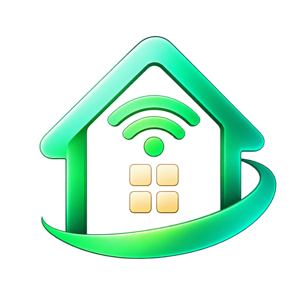
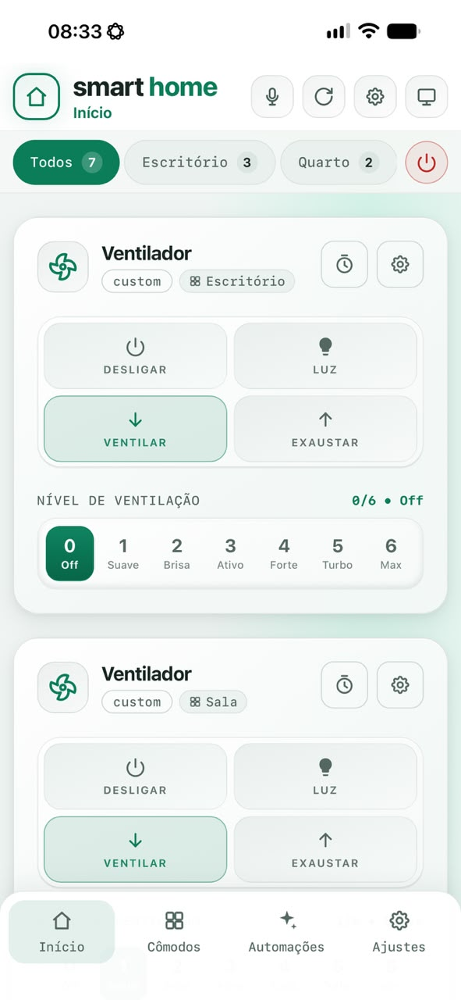

  

<h1 align="center">Documentação</h1>

- [`../contracts/`](../contracts/) — manifesto, comandos, API HTTP e ingest do hub.
- [`../firmware/smart_control/README.md`](../firmware/smart_control/README.md) — firmware.
- [`../hub/README.md`](../hub/README.md) — hub Go.
- [`../README.md`](../README.md) — visão geral e decisões.

## Capturas de tela

  

